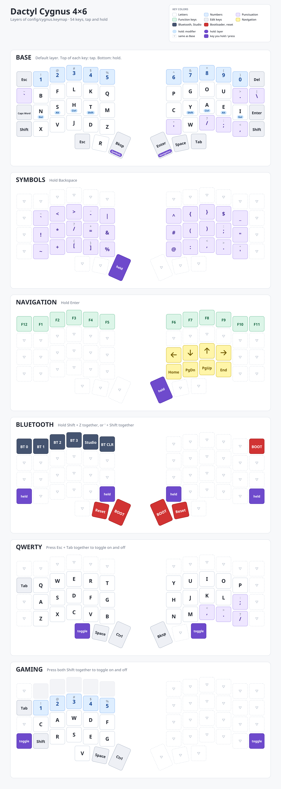

# Dactyl Cygnus 4x6

ZMK config for a wireless split Dactyl Cygnus 4x6 (Seeed XIAO BLE in each half), using a
[Prospector](https://github.com/carrefinho/prospector-zmk-module) as a dongle.

Much of the code for this comes from <https://github.com/juhakaup/zmk-cygnus-4x6>

## Firmware

Firmware is built by GitHub Actions on every push. Download it from the [Actions tab](../../actions).

| Build | Flash to |
| --- | --- |
| `cygnus_dongle prospector_adapter` | The Prospector dongle (BLE central, connects to the host over USB/BT) |
| `cygnus_left` / `cygnus_right` | Each keyboard half (BLE peripherals) |
| `settings_reset` | Any device, to wipe its pairing/settings before reflashing |
| `tester_xiao` | A XIAO, for testing the switch wiring |

The halves only work with the dongle. If they won't connect after flashing,
flash `settings_reset` to all three devices, then reflash the normal firmware.

## Keymap

Hold Backspace for Symbols, hold Enter for Navigation, and hold Shift + Z (or `'` + Shift) for Bluetooth.
Press Esc + Tab together to toggle Qwerty, and both Shifts together to toggle Gaming.



A faint grey key does nothing. A dashed key (▽) passes through to the Base layer. The purple key is the one you
hold (or press, for a toggle) to reach that layer.

The picture is drawn from `config/cygnus.keymap` by `tools/draw-keymap.py`. Redraw it after changing the keymap
and commit it along with the change. On NixOS the script fetches its own Python and pycairo; elsewhere it needs
`pycairo` and the Noto Sans font.

```sh
tools/draw-keymap.py
```

## Keymap Editing

The keymap lives in `config/cygnus.keymap`.

### ZMK Studio (Recommended)

Studio is enabled on the dongle only.

1. Connect the dongle via USB
2. Unlock Studio: hold the Bluetooth layer combo (`Shift` + `Z` on the left, or `'` + `Shift` on the right)
   and press the `Studio Unlock` key (top row, 5th from the left)
3. Open [ZMK Studio](https://zmk.studio/) (web or desktop app) and connect to the keyboard

### Online Keymap Editor

Alternatively, you can edit your keymap using the web-based keymap editor:

1. Visit <https://nickcoutsos.github.io/keymap-editor/>
2. Edit your keymap visually through the web interface
3. Commit changes directly through the editor
4. Download GitHub Actions built firmware from the [Actions tab](../../actions)
